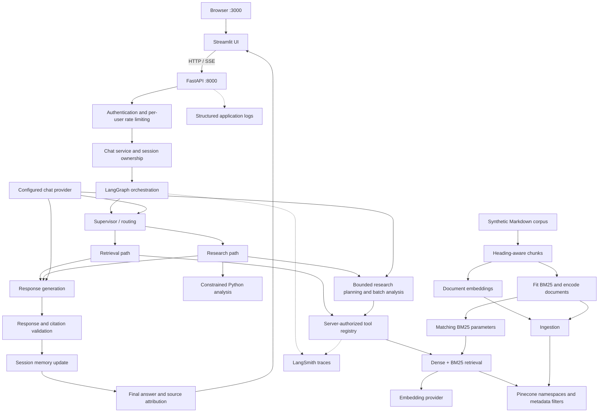

# Lanka Meridian Bank AI Assistant

Research totals count unique documents; multiple findings preserve evidence without inflating totals. See [analysis integrity](docs/analysis_integrity.md) and [provider compatibility](docs/vllm_serving.md).

See [current assumptions](docs/ASSUMPTIONS.md) for fail-closed API_TOKENS overrides, sanitized node errors, final UI states and current deployment limitations.

See [runtime integration notes](docs/runtime_integration.md) for final validation fields, public health behavior, timeout configuration and provider setup.

See [security and reliability update notes](docs/security_review_changes.md) for the manual-merge audit, validation commands and outstanding assessment items.

An assessment proof of concept for an enterprise knowledge assistant built with FastAPI, Streamlit, LangGraph and Pinecone.

The assistant answers questions using a synthetic organizational document collection, maintains conversational context during a session, performs bounded multi-step research, and exposes agent activity through a streaming interface.

The project emphasizes explainable control flow, evidence-backed answers, server-enforced authorization, observability and graceful degradation.

This is an assessment POC, not a production banking application.

## Project status

Implemented capabilities include:

- FastAPI chat and streaming APIs.
- Streamlit conversational interface with an agent activity panel.
- LangGraph orchestration with specialized routing, retrieval, research and response responsibilities.
- Dense and sparse retrieval using Pinecone and BM25.
- Simplified Recursive Language Model research.
- Session-scoped conversational memory.
- Role-based document access and tool authorization.
- Input validation and response/citation guardrails.
- Per-user token-bucket rate limiting.
- Structured application logging and LangSmith integration.
- Failure-drill coverage for provider failures, retrieval failures, authorization, timeouts and interrupted generation.

Latest reported failure-drill result:

| Metric | Result |
|---|---:|
| Test cases | 14 |
| Passed | 14 |
| Failed | 0 |
| Errors | 0 |
| Skipped | 0 |
| Runner complete | true |
| Pytest exit code | 0 |

This result covers the failure-drill suite. It is not a claim that all application tests, container builds, external integrations or production scenarios have been validated.

API and UI container definitions are provided separately. Container packaging must pass build and smoke checks in the target environment before it is considered verified.

## Contents

- [Architecture](#architecture)
- [Request lifecycle](#request-lifecycle)
- [Retrieval design](#retrieval-design)
- [Research and RLM design](#research-and-rlm-design)
- [Memory](#memory)
- [Security and authorization](#security-and-authorization)
- [Streaming interface](#streaming-interface)
- [Model and provider configuration](#model-and-provider-configuration)
- [Local setup](#local-setup)
- [Docker Compose setup](#docker-compose-setup)
- [API usage](#api-usage)
- [Configuration reference](#configuration-reference)
- [Observability](#observability)
- [Testing and failure drills](#testing-and-failure-drills)
- [Assumptions and trade-offs](#assumptions-and-trade-offs)
- [Known limitations](#known-limitations)
- [Troubleshooting](#troubleshooting)
- [Assessment demonstration](#assessment-demonstration)
- [Repository layout](#repository-layout)

## Architecture



The diagram describes logical responsibilities. It does not imply that each box is an independently deployed service or a separate model.

The runtime is a FastAPI application plus a Streamlit application. Pinecone, model serving and LangSmith are external dependencies.

The current packaging does not provision model servers or cloud infrastructure.

## Request lifecycle

1. The user submits a message through Streamlit or the API.
2. The backend authenticates the API key and applies per-user rate limits.
3. The chat service checks session ownership.
4. LangGraph routes the request to the relevant workflow.
5. Retrieval and research operations execute through authorized tools.
6. Retrieved evidence is used to generate an answer.
7. Validation checks the response and source attribution.
8. The service emits a final result and updates session memory according to the workflow.

Streaming requests also emit activity updates so the UI can show progress.

Agent activity is operational transparency: routing decisions, tool activity, retrieval status and validation results. It is not a promise to expose private model reasoning.

## Retrieval design

### Pipeline

```text
Documents
  → heading-aware chunks
  → dense embeddings and sparse BM25 encoding
  → Pinecone storage
  → authorized hybrid retrieval
  → score filtering and per-document limits
  → evidence-grounded generation
```

No separate learned reranker is claimed in this implementation. Score filtering and per-document limits are not equivalent to cross-encoder reranking.

### Dense retrieval

Dense embeddings support semantic matching between questions and passages.

Document ingestion and query retrieval must use compatible:

- Embedding models.
- Vector dimensions.
- Provider behavior.
- Query/document formatting conventions.

Changing the embedding model is not a safe configuration-only change for an existing index. Existing document vectors may need to be regenerated.

### Sparse retrieval

BM25 supports keyword-sensitive retrieval, including exact technical terms.

The sparse encoder is fitted during ingestion and saved to:

```text
data/bm25_params.json
```

Query-time retrieval loads the saved parameters.

The encoder artifact must correspond to the corpus and sparse document vectors already stored in Pinecone. Refitting it independently against a changed corpus can make query and document sparse representations inconsistent.

### Hybrid scoring

The implementation combines dense and sparse contributions using `HYBRID_ALPHA`.

Conceptually:

```text
dense contribution  = alpha × dense vector
sparse contribution = (1 - alpha) × sparse vector
```

The intended index uses a compatible dot-product hybrid configuration.

Additional controls include:

- `RETRIEVAL_MIN_SCORE`: minimum retrieval score.
- `RETRIEVAL_MAX_PER_DOC`: maximum retained results per document.
- `EMBEDDING_CACHE_SIZE`: query embedding cache capacity.

Retrieval scores are ranking signals, not calibrated probabilities of correctness.

### Namespaces and authorization

Pinecone namespaces represent document types:

- `incident`
- `runbook`
- `architecture`
- `product_spec`
- `meeting_notes`
- `policy`

Namespaces organize the corpus. They are not the primary user authorization boundary.

Role-based document access uses metadata filtering through the authorized retrieval path.

### Missing BM25 artifact

If BM25 parameters cannot be loaded, the current retrieval factory logs a warning and falls back to dense-only retrieval.

That is degraded operation. A responding API does not prove hybrid retrieval is active.

Do not regenerate the corpus or recreate the index during ordinary application startup.

## Research and RLM design

The research workflow demonstrates simplified Recursive Language Model concepts:

- Explore the accessible document collection.
- Decompose broad questions into smaller tasks.
- Retrieve targeted evidence.
- Analyze bounded batches.
- Aggregate findings into a response.

The local document catalog is constructed from `DOCS_DIR`. It must remain consistent with the indexed corpus.

Research searches also pass through the authorized tool path. A research sub-agent must not gain broader access than the initiating user.

### Why this approach

Large comparison and incident-analysis questions can exceed a useful single retrieval window. Bounded decomposition allows the system to analyze smaller evidence sets and combine results.

### Trade-offs

- More sub-tasks increase latency and model usage.
- Retrieval omissions can affect the final aggregate.
- Bounded research may provide partial coverage.
- Aggregation can lose detail from individual documents.
- This is a simplified research implementation, not an unrestricted autonomous agent or a complete reproduction of an RLM research system.

The Python analysis capability should be described as constrained structured analysis, not a general-purpose secure sandbox for arbitrary generated code.

## Memory

The assistant maintains conversational context across turns within a session.

The UI creates a new session identifier when:

- A new conversation starts.
- The selected demo identity changes.

The backend checks session ownership and rejects reuse by a different user.

### Design choice

Session memory supports contextual follow-up questions without requiring a persistent user-profile store.

### Limitations

- Memory is process-local in the current POC.
- An API process restart does not provide durable conversation recovery.
- Multiple independent workers or replicas do not share this state.
- Session ownership is not a substitute for production identity management.
- Long-term cross-session memory is not claimed.

Run the API with one worker until memory, ownership and rate-limiting state are moved to appropriate shared infrastructure.

## Security and authorization

### Demo authentication

The POC uses predefined identities and API keys.

| Demo identity | User ID | Default demo API key |
|---|---|---|
| Viewer | `viewer1` | `dev-viewer-key` |
| Analyst | `analyst1` | `dev-analyst-key` |
| Administrator | `admin1` | `dev-admin-key` |

These values are demo credentials, not production secrets or a secure public authentication mechanism.

The Streamlit role selector deliberately allows switching between demonstration identities. Do not expose it publicly as production login.

The UI API-key environment variables configure the client. They do not modify the backend user registry.

### Role model

| Role | Intended capability |
|---|---|
| Viewer | Chat and authorized knowledge search |
| Analyst | Search, permitted research/analytics and enterprise tools |
| Administrator | All registered tools subject to validation and guardrails |

The backend user and tool definitions are authoritative.

Document access tiers are hierarchical in the project design:

- Viewer: public and internal.
- Analyst: additionally confidential.
- Administrator: additionally restricted.

Verify the current definitions in `app/auth/` when changing policies.

### Enforcement

- Authentication runs on the server.
- Tool access is checked by the server-side registry.
- Client-provided role fields do not grant permissions.
- Tool parameters are validated.
- Session ownership is checked.
- Retrieved evidence and generated responses pass through guardrails.
- Per-user token-bucket limits restrict request frequency.

### Prompt injection

The corpus includes an intentional prompt-injection fixture.

The design treats retrieved documents as evidence, not as instructions that may override application policy or grant tool access.

Prompt-injection protection is defense in depth, not a guarantee that every adversarial input will be detected.

### Deployment boundary

The default Compose setup should publish API and UI ports only on host loopback:

```yaml
ports:
  - "127.0.0.1:8000:8000"
```

and:

```yaml
ports:
  - "127.0.0.1:3000:3000"
```

Production use would require stronger authentication, transport security, secret management, operational controls and a dedicated security review.

## Streaming interface

The Streamlit UI displays:

- Conversation history.
- Agent state and active node.
- Retrieval updates.
- Tool/activity events.
- Validation results.
- Memory updates.
- Final answers and source attribution.
- Degraded or blocked-result indicators.

The UI consumes the FastAPI Server-Sent Events endpoint.

### Provisional tokens

Provisional response display is optional and disabled by default.

Provisional tokens have not necessarily passed final validation. They should not be treated as approved answers.

For safer demonstrations, leave provisional token display disabled and rely on the final validated result.

### Interrupted streams

If the connection ends without a final result, the UI reports an error rather than presenting the incomplete turn as a successful final answer.

After an interrupted turn, start a new conversation if session context appears inconsistent.

## Model and provider configuration

The implementation uses configurable model access.

The repository currently contains configuration examples for local Qwen models through vLLM, while the settings defaults also reference OpenRouter-compatible hosted models.

Do not treat either example as proof of the currently deployed provider. The active environment configuration determines the runtime selection.

### Shared configuration

The supplied settings expose:

```dotenv
BASE_URL=
API_KEY=
LLM_MODEL=
EMBEDDING_MODEL=
EMBEDDING_DIM=
```

Do not assume there is a supported `EMBEDDING_BASE_URL` setting.

Before using separate chat and embedding servers, inspect the clients in:

```text
app/llm.py
app/retrieval/embeddings.py
```

The shown configuration alone does not establish independent provider routing.

### Local model rationale

Local model serving can reduce external transmission of prompts to a hosted LLM provider and offer control over inference infrastructure.

Trade-offs include:

- GPU and model-serving requirements.
- Operational complexity.
- Model-dependent reasoning and instruction-following quality.
- Resource contention and latency.
- Responsibility for endpoint security.

Local model serving does not mean the entire system is offline. Pinecone and LangSmith are external services in this architecture.

### Hosted model rationale

A hosted provider can simplify inference operations and offer access to different model capabilities.

Trade-offs include:

- Network dependence.
- Provider availability and quotas.
- Usage cost.
- Data-handling and retention considerations.

Only synthetic assessment data should be used unless external-service data handling has been explicitly approved.

## Local setup

### Prerequisites

- Python 3.12 for consistency with the current container proposal and test environment.
- Access to the configured model provider.
- A configured Pinecone index.
- LangSmith credentials for tracing.
- An existing corpus and matching retrieval artifacts.

### Install

```bash
python -m venv .venv
source .venv/bin/activate

python -m pip install -r requirements.txt
python -m pip check
```

Create a configuration file only if one does not already exist:

```bash
if [ ! -f .env ]; then
  cp .env.example .env
fi
```

Edit `.env` with the intended provider, model and service settings.

Never commit the real `.env`.

### Corpus and ingestion

For an existing working setup, reuse the existing corpus, Pinecone index and matching BM25 artifact.

For a deliberate first-time setup, inspect the scripts before running:

```bash
python scripts/generate_mock_docs.py
python -m scripts.ingest --help
```

Generate documents only when initializing or intentionally regenerating the synthetic corpus.

The ingestion pipeline affects:

```text
chunk → embed → store
```

Index recreation is a separate destructive operation. Do not use `--recreate` as a normal startup command.

The original corpus is described as 36 documents, distributed across incidents, runbooks, architecture, product specifications, meeting notes and policies. Verify current generated counts rather than relying on stale category totals.

### Start the API

```bash
python -m uvicorn app.api.main:app \
  --host 127.0.0.1 \
  --port 8000 \
  --workers 1
```

### Start the UI

In another terminal:

```bash
source .venv/bin/activate

UI_API_BASE_URL=http://127.0.0.1:8000 \
python -m streamlit run ui/app.py \
  --server.address 127.0.0.1 \
  --server.port 3000
```

Open:

- UI: http://127.0.0.1:3000
- API documentation: http://127.0.0.1:8000/docs

An explicit `UI_API_BASE_URL` is important because the supplied UI source still has an older fallback port.

## Docker Compose setup

### Images

The API and UI have separate Dockerfiles:

| Component | Dockerfile | Image |
|---|---|---|
| API | `Dockerfile.api` | `orysys-api:local` |
| UI | `Dockerfile.ui` | `orysys-ui:local` |

Both currently install the shared `requirements.txt`.

This favors a simple initial packaging setup over minimal image size. Dependencies have not yet been separated into API-only and UI-only manifests.

### Port contract

This README uses:

| Component | Host port | Container listening port |
|---|---:|---:|
| API | 8000 | 8000 |
| UI | 3000 | 3000 |

Keep these consistent across:

- Dockerfile startup commands.
- Dockerfile `EXPOSE` declarations.
- Compose port mappings.
- Health-check URLs.
- `UI_API_BASE_URL`.
- Local commands and documentation.

Inside Compose:

```dotenv
UI_API_BASE_URL=http://api:8000
```

For a locally launched UI:

```dotenv
UI_API_BASE_URL=http://127.0.0.1:8000
```

If only host ports are remapped, container-to-container requests must continue using the actual container listening port.

### Host-run model servers

Inside the API container, `localhost` refers to that container.

For a model server running on the Docker host, the Compose proposal includes:

```yaml
extra_hosts:
  - "host.docker.internal:host-gateway"
```

A host model URL may therefore use:

```dotenv
BASE_URL=http://host.docker.internal:8001/v1
```

The port above is an example, not a new project default.

The model server must actually listen on that port and on an interface reachable from Docker.

Because the API now publishes host port 8000, a host-run vLLM server cannot also occupy the same host address and port. Move one service and update the relevant configuration.

Do not change a hosted provider URL to `host.docker.internal`.

### Runtime data

The proposed Compose setup mounts:

```text
./data → /app/data
```

read-only.

The API receives:

```dotenv
DOCS_DIR=/app/data/docs
BM25_PARAMS_PATH=/app/data/bm25_params.json
```

No ingestion occurs automatically during container startup.

### Build and start

```bash
docker compose config --quiet
docker compose build api ui
docker compose up -d

docker compose ps
docker compose logs --tail=100 api ui
```

Do not share unrestricted `docker compose config` output: resolved configuration can include credentials.

### Stop

```bash
docker compose down
```

### Container health

Use the following API liveness URL after changing the port:

```text
http://127.0.0.1:8000/openapi.json
```

Use the following UI health URL:

```text
http://127.0.0.1:3000/_stcore/health
```

The API liveness probe checks application availability after startup. It does not prove that Pinecone, embeddings, chat generation or LangSmith are working.

## API usage

### Endpoints

| Method | Path | Purpose |
|---|---|---|
| GET | `/docs` | Interactive API documentation |
| GET | `/openapi.json` | OpenAPI schema |
| GET | `/health` | Application health with an LLM check |
| POST | `/chat` | Non-streaming chat |
| POST | `/chat/stream` | Streaming chat and activity |
| POST | `/tools/execute` | Authorized tool execution |

### Chat

```bash
curl --silent --show-error \
  http://127.0.0.1:8000/chat \
  -H 'X-API-Key: dev-analyst-key' \
  -H 'Content-Type: application/json' \
  -d '{
    "message": "What is the runbook for connection pool saturation?",
    "session_id": "readme-demo-001"
  }'
```

### Streaming

```bash
curl --no-buffer \
  http://127.0.0.1:8000/chat/stream \
  -H 'X-API-Key: dev-analyst-key' \
  -H 'Content-Type: application/json' \
  -d '{
    "message": "Summarize recurring payment incident causes.",
    "session_id": "readme-demo-002"
  }'
```

Use the same session ID for a contextual follow-up by the same identity.

### Request validation

The supplied chat schema requires:

- `message`: 1–4000 characters.
- Optional `session_id`: 8–64 characters.
- Session characters: letters, digits, underscores and hyphens.

The Streamlit input currently applies a stricter 2000-character limit.

### Error semantics

Relevant responses include:

| Status | Meaning |
|---|---|
| 401 | Missing or invalid API key |
| 403 | Unauthorized operation or session ownership violation |
| 422 | Invalid request or tool parameters |
| 429 | Per-user rate limit reached |
| 503 | Tool unavailable |
| 504 | Tool timeout |

Chat workflows can also return a safe degraded result with HTTP 200. Inspect the response content, validation state and degraded indicator rather than treating every HTTP 200 as a fully successful answer.

### Health

```bash
curl --silent --show-error \
  http://127.0.0.1:8000/health
```

The existing endpoint invokes an LLM health check and may report:

```json
{
  "status": "degraded"
}
```

Inspect the JSON body. A successful HTTP request alone is not a provider-readiness guarantee.

Do not expose detailed health information publicly without reviewing its error-disclosure behavior.

## Configuration reference

Use `.env.example` as a template, not as proof that its model values match an existing index.

### Models

| Variable | Purpose |
|---|---|
| `BASE_URL` | Configured model API base URL |
| `API_KEY` | Model provider credential |
| `LLM_MODEL` | Chat model identifier |
| `LLM_MAX_TOKENS` | Generation token limit |
| `LLM_TIMEOUT_SEC` | Model request timeout |
| `LLM_MAX_RETRIES` | Model retry limit |
| `EMBEDDING_MODEL` | Embedding model identifier |
| `EMBEDDING_DIM` | Expected embedding dimensions |
| `EMBEDDING_QUERY_INSTRUCTION` | Query embedding instruction |

### Pinecone and retrieval

| Variable | Purpose |
|---|---|
| `PINECONE_API_KEY` | Pinecone credential |
| `PINECONE_INDEX` | Index name |
| `PINECONE_CLOUD` | Provisioning configuration |
| `PINECONE_REGION` | Provisioning configuration |
| `DOCS_DIR` | Local document catalog directory |
| `BM25_PARAMS_PATH` | Saved sparse encoder parameters |
| `HYBRID_ALPHA` | Dense/sparse weighting |
| `RETRIEVAL_MIN_SCORE` | Minimum retained score |
| `RETRIEVAL_MAX_PER_DOC` | Per-document result limit |
| `EMBEDDING_CACHE_SIZE` | Query embedding cache capacity |

Changing cloud or region settings does not migrate an existing index.

### Limits

| Variable | Purpose |
|---|---|
| `RATE_LIMIT_CAPACITY` | Per-user token-bucket capacity |
| `RATE_LIMIT_REFILL_PER_SEC` | Bucket refill rate |
| `TOOL_TIMEOUT_SEC` | Tool timeout configuration |

### UI

| Variable | Purpose |
|---|---|
| `UI_API_BASE_URL` | API address used by the Streamlit server |
| `UI_VIEWER_API_KEY` | Viewer client credential |
| `UI_ANALYST_API_KEY` | Analyst client credential |
| `UI_ADMIN_API_KEY` | Administrator client credential |

API keys remain in the Streamlit server process rather than being supplied directly by browser JavaScript.

### LangSmith

| Variable | Purpose |
|---|---|
| `LANGSMITH_TRACING` | Enable tracing |
| `LANGSMITH_ENDPOINT` | Workspace/region endpoint |
| `LANGSMITH_API_KEY` | LangSmith credential |

The example also includes `LANGSMITH_AGENT_ID` and
`LANGSMITH_AGENT_ENVIRONMENT`. Verify how the application consumes
these before assuming they control trace metadata.

See [config_guide.md](config_guide.md) for setup notes.

## Observability

### Structured logs

Application logs include operational details such as:

- Request identifiers.
- Request paths and status codes.
- Request timing.
- Retrieval failures.
- Tool execution and denials.
- Workflow errors and fallback behavior.

Streaming request timing in middleware is not necessarily the complete time required to generate the final streamed answer.

### LangSmith

LangSmith is the tracing system used for the assessment.

Verify that a real conversation produces inspectable traces for the relevant graph, model and tool operations. Configuration alone is not proof that every operation is traced.

Useful inspection points include:

- Agent transitions.
- Model calls.
- Retrieval operations.
- Tool execution.
- Research decomposition.
- Failure and fallback paths.

### Data handling

Logs and traces can contain prompts, document content and exception details.

Current failure-drill logs demonstrate that raw exception messages can appear in server-side tracebacks even when client responses are safe.

Do not place real secrets in exception messages. Apply access control, redaction and retention policies before using sensitive data.

## Testing and failure drills

### Full regression suite

```bash
python -m pytest -q
```

### Failure drills

```bash
python -m scripts.run_failure_drills
```

The runner writes timestamped reports under:

```text
failure-drill-results/
```

Latest reported coverage includes:

1. Vector database failure.
2. Retrieval timeout.
3. Response-provider failure.
4. Router failure.
5. Research failure.
6. Invalid authentication and request shape.
7. Cross-user session reuse.
8. Per-user rate limiting before SSE headers.
9. Tool denial and role-override rejection.
10. Enterprise-tool timeout.
11. Enterprise-tool outage.
12. Whole-turn timeout.
13. Disconnect cancellation.

Expected successful summary:

```json
{
  "tests": 14,
  "failed": 0,
  "errors": 0,
  "skipped": 0,
  "passed": 14,
  "complete": true,
  "pytest_exit_code": 0
}
```

The count may increase as tests are added.

Injected-failure tests can intentionally produce warning and error logs. Judge the outcome using assertions, pytest status and the runner summary.

### Container smoke checks

```bash
docker compose ps

curl --fail --silent --show-error \
  http://127.0.0.1:8000/openapi.json > /dev/null

curl --fail --silent --show-error \
  http://127.0.0.1:3000/_stcore/health

curl --silent --show-error \
  http://127.0.0.1:8000/health
```

Then verify a real UI conversation, source attribution and LangSmith trace.

## Assumptions and trade-offs

| Decision | Reason | Trade-off |
|---|---|---|
| Synthetic bank corpus | Safe, repeatable assessment data | Does not establish performance on real enterprise data |
| Streamlit UI | Fast implementation and visible agent activity | Demo UX and identity switching are not production authentication |
| LangGraph orchestration | Explicit workflow state and routing | More orchestration complexity than a simple retrieval chain |
| Bounded research | Demonstrates decomposition without unlimited exploration | Partial coverage and aggregation loss remain possible |
| Pinecone namespaces by document type | Clear corpus organization | Authorization still requires metadata enforcement |
| Dense plus BM25 retrieval | Semantic and keyword-sensitive matching | Requires compatible sparse artifacts and score tuning |
| One chat model across agent roles | Simpler model operations | Different tasks may benefit from different models |
| Session-scoped memory | Supports contextual follow-ups with low setup cost | Not durable or shared across replicas |
| One API worker | Consistent process-local state for the POC | Limits horizontal scaling |
| Dense-only fallback | Preserves some availability when BM25 is missing | Reduced retrieval behavior; must be disclosed |
| Extractive/safe fallback responses | Avoid fabricated answers during provider failure | Less fluent or incomplete responses |
| Separate API/UI images | Independent packaging and startup | Shared dependency manifest still makes images larger |
| Lower-bound dependency requirements | Simple development setup | Builds are not fully reproducible over time |
| External Pinecone and LangSmith | Managed retrieval and tracing | Network dependence, cost and data-handling considerations |

For date-relative research demonstrations, state the reference date explicitly. Existing assessment assumptions use October 2026; “last year” should not silently change meaning between demonstrations.

The assessment brief specifies a 45-minute video. Do not reinterpret that as five minutes unless the evaluator explicitly approves the change.

## Known limitations

- Not a production banking application.
- Demo API keys and UI identity selection are not production login.
- No distributed session-memory backend.
- No durable cross-session memory guarantee.
- No distributed rate-limiting guarantee across workers or replicas.
- No separate learned reranker is claimed.
- No production TLS or gateway configuration is included.
- No automatic provisioning of model-serving infrastructure.
- Chat/embedding endpoint separation must be verified in the client code.
- Dependency versions and base images are not fully locked.
- Missing BM25 parameters allow degraded dense-only operation.
- Retrieval can miss relevant evidence.
- Citation validation does not prove every factual claim is correct.
- Prompt-injection defenses are incomplete by nature.
- Provisional streamed tokens are not validated final answers.
- External service failures can prevent complete answers.
- Enterprise data/tools are mocked; a production MCP integration is not claimed.
- A general-purpose secure execution sandbox is not claimed.
- Log and trace redaction require further hardening.
- Container startup success does not prove end-to-end retrieval quality.
- The reported 13 passing drills do not establish load-test or production readiness.

## Troubleshooting

### UI cannot reach the API

Check:

```bash
docker compose ps
docker compose logs --tail=100 api ui
```

Inside Compose:

```dotenv
UI_API_BASE_URL=http://api:8000
```

For a local UI process:

```dotenv
UI_API_BASE_URL=http://127.0.0.1:8000
```

Recreate the UI container after changing its runtime environment.

### Port 8000 is already in use

A local model server may already use port 8000.

The API and model server cannot bind the same host address and port simultaneously.

Choose a different model-serving port and update `BASE_URL`, or change the API port consistently across commands, Compose, health checks and UI configuration.

### API reports degraded health

Inspect the JSON response and API logs.

Check:

- Model endpoint reachability.
- Provider credentials.
- Model identifier.
- Timeouts and quotas.
- Host/container networking.

### “BM25 params not loaded”

Confirm:

```bash
test -s data/bm25_params.json
```

Check the mounted path and ensure the artifact matches the indexed corpus.

Do not blindly refit BM25 or recreate the index to silence the warning.

### Embedding errors or dimension mismatch

Compare the active query embedding configuration with the model and dimensions used during ingestion.

Do not switch models merely to satisfy a sample configuration.

### No LangSmith traces

Check:

- `LANGSMITH_TRACING`.
- Endpoint and API key.
- Network access.
- Environment loading.
- Actual traced execution.

The project loads `.env` into `os.environ` because tracing integrations read process environment variables.

### 403 on an existing session

The session may belong to another user.

Start a new conversation after switching identities. Do not bypass session ownership checks.

### 429 response

The user's token bucket is exhausted.

Respect the retry information and allow the bucket to refill. Adjust limits deliberately rather than disabling the control.

### Stream ends without a final answer

Inspect API logs and provider health.

The UI treats a missing final event as a failed turn. Start a new conversation if context consistency is uncertain.

## Assessment demonstration

Suggested walkthrough:

1. Explain architecture and trust boundaries.
2. Show provider configuration without exposing credentials.
3. Demonstrate cited knowledge retrieval.
4. Ask a contextual follow-up.
5. Demonstrate bounded research across incident documents.
6. Show role-based document/tool restrictions.
7. Demonstrate prompt-injection handling.
8. Show a degraded or timeout path.
9. Inspect LangSmith traces.
10. Explain assumptions, limitations and production improvements.

Required submission items include:

- Public source repository.
- Architecture diagram.
- Public demo-video URL.
- LangSmith traces shown in the demo.
- Assumptions and trade-offs explained in the demo.

Before making the repository public, review files and Git history for credentials and sensitive data. Do not publish raw traces or reports without checking their contents.

## Repository layout

```text
app/
  api/                 FastAPI routes, service, SSE and production wiring
  auth/                Demo identities and authentication/authorization
  graph/               LangGraph orchestration
  retrieval/           Chunking, embeddings, caching and hybrid retrieval
  rlm/                 Research catalog, planning and execution
  security/            Guardrails and security controls
  tools/               Tool registry and authorized tool wiring
  config.py            Application settings
  env.py               Environment loading
  llm.py               Chat model integration
  logging_config.py    Structured logging

ui/
  app.py               Streamlit application
  client.py            API and streaming client

scripts/               Ingestion, validation and utility commands
tests/                 Automated tests
data/                  Synthetic corpus and local retrieval artifacts
docs/                  Architecture, stage notes and trade-offs

Dockerfile.api         API image
Dockerfile.ui          UI image
compose.yaml           Local API/UI orchestration
.dockerignore          Build-context exclusions
.env.example           Configuration template
requirements.txt       Shared Python dependencies
config_guide.md        Configuration documentation
README.md              Project overview and setup
```

## Change discipline

- Keep README and configuration documentation synchronized.
- Preserve the existing repository structure.
- Review staged changes and run validation before committing.
- Do not commit real credentials or unrestricted runtime reports.
- Do not recreate indexes as part of normal startup.
- Do not publish, push or deploy without explicit approval.