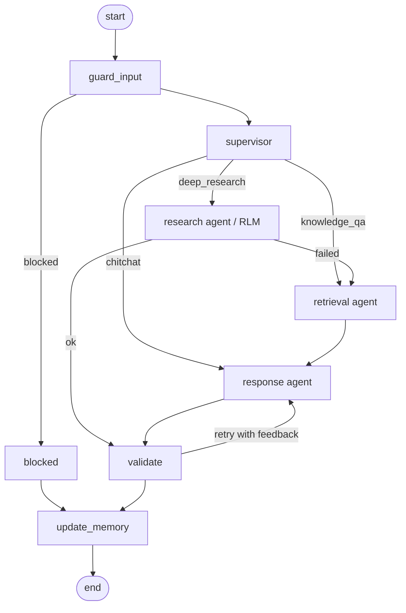

# T2: LangGraph orchestration, streaming API, memory, guardrails

## Graph

The shape is declared once in `app/graph/topology.py`. `builder.py` turns it into a LangGraph `StateGraph`, and the unit
test runner executes the same table, so the tested edges are the production edges.

## Agents
| Node | Role |
|---|---|
| guard_input | length and control character checks, injection screening, per-turn state reset |
| supervisor | intent, standalone query rewrite using memory, filters. Server side policy then enforces role limits |
| retrieval | hybrid search (T1) with role filter, emits namespaces, degraded flags, timings |
| research | RLM engine (T3), forwards its steps as `rlm.*` events |
| response | streams the grounded answer with citations |
| validate | deterministic guardrails, retry loop with feedback, sanitising fallback |
| update_memory | stores the turn, rolling summary, profile, episodes |

## Activity events (SSE `event:` names)
`node_start`, `node_end`, `node_error`, `state`, `input_guard`, `routing`, `policy`, `retrieval_start`, `retrieval`,
`rlm.*`, `generation_start`, `token`, `generation_failed`, `validation`, `memory_loaded`, `memory_updated`, `final`, `error`.
Each frame: `{seq, ts, type, node, data}`. Streamed `token` events are provisional: guardrails run after generation, so
the `final` event is authoritative and the UI must replace the streamed text with it. `generation_start` with `reset: true`
means a retry started and the UI should clear the partial answer.

## Memory design decisions
1. Short term: last 6 messages verbatim, persisted by the LangGraph checkpointer per thread (`thread_id` = session).
   POC uses `MemorySaver`. Production would use a SQLite or Postgres checkpointer.
2. Rolling summary: turns that leave the window are condensed by the LLM (120 words), summarised in whole turns.
   Prompt size stays constant in long chats. If the summariser fails, a deterministic fallback keeps working.
3. Episodes and profile: each answered question is stored with cited doc ids. The supervisor receives the most relevant earlier
   episodes (lexical overlap), which resolves follow-ups ("how was it fixed?"). The profile holds recent topics and documents seen.
4. Safety: blocked input is never stored (no memory poisoning), only the answer the user actually saw is stored (memory cannot
   exceed the user's role), and a session is bound to its first user (403 for anyone else).

## Failure handling
| Failure | Behaviour |
|---|---|
| supervisor LLM down or invalid JSON | heuristic routing, event `policy` |
| vector DB down or timeout | answer says search is unavailable, no crash |
| no relevant chunks | fixed "could not find" reply, the LLM is not called (no hallucination) |
| response LLM down | extractive fallback with citations, `degraded: true` |
| research engine fails | falls back to standard search, user is told |
| node raises | isolated by `wrap_node`, `node_error` event, turn continues |
| client disconnects | the turn task is cancelled, bus removed |
| unexpected error | `error` event plus generic apology, no internals exposed |

## LangSmith
Tracing is automatic with `LANGSMITH_TRACING=true`. Every turn is a root run named `assistant_turn` with tags `role:<role>` and
metadata `thread_id`, `session_id`, `user_id`, `request_id`, so a whole conversation appears as one LangSmith thread. Nodes and LLM
calls are child runs, and the Pinecone search is a `hybrid_search` retriever run.

## API
`POST /chat/stream` (SSE), `POST /chat` (JSON), `GET /health`. Auth: `X-API-Key` (hardcoded users, Option A). Run with
`uvicorn app.api.main:app --port 8000`, try `python -m scripts.chat_cli analyst1 "..."`.
